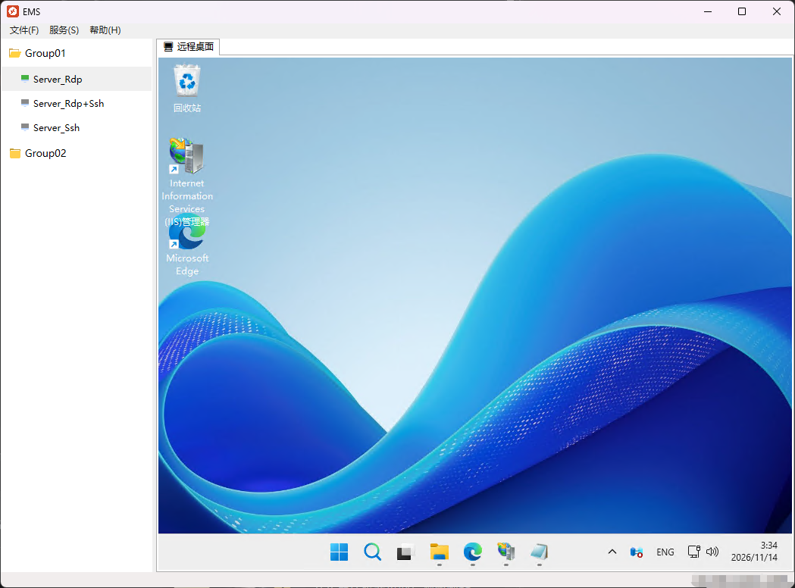
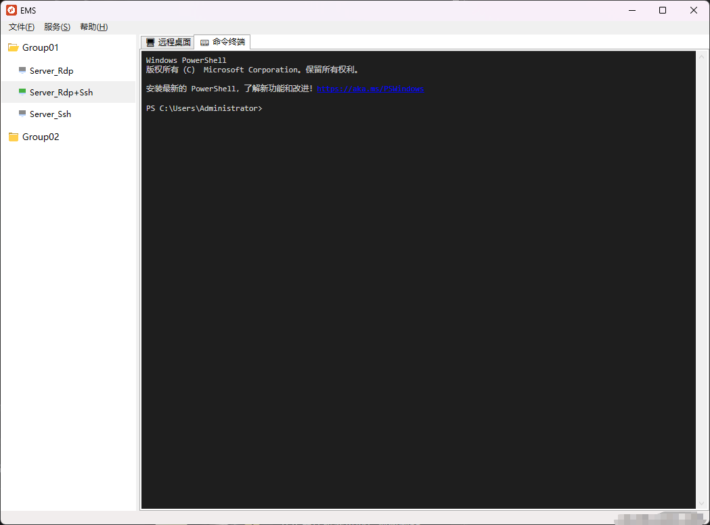
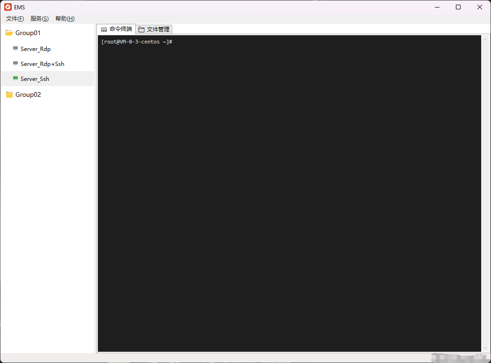
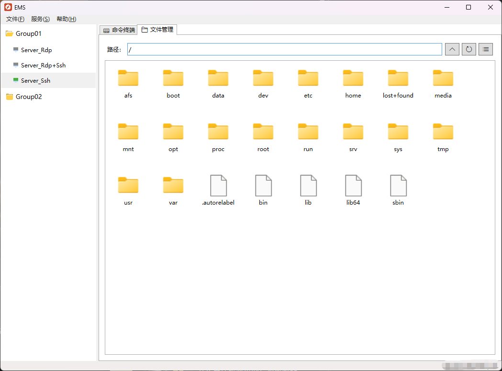

# EMS — Remote Connection Manager for Windows

[中文文档](README_CN.md)

EMS is a Windows desktop tool for remote operations. It manages SSH / RDP connections in one place, with a built-in terminal, an SFTP file manager, and an embedded **MCP (Model Context Protocol) server** that lets AI assistants run commands and transfer files on servers you have connected to.

## Screenshots

**RDP remote desktop** (resolution auto-matches the visible area)



**RDP + SSH combo** (remote desktop tab + command terminal tab, shared credentials)



**SSH terminal** (embedded terminal with OSC 133 shell integration)



**SSH + file manager** (Explorer-style SFTP browsing, drag & drop / copy & paste / transfer queue)



## Features

### Connection management
- Server groups with account/password inheritance; default port follows the connection type
- **SSH**: embedded terminal (XTerm.NET) with OSC 133 shell integration for precise command output capture and exit codes
- **RDP**: embedded ActiveX remote desktop control (mstscax); resolution auto-matches the visible area; background warm-up at startup eliminates the first-load freeze
- **RDP + SSH combo**: remote desktop tab + command terminal tab (lazy-loaded SSH side connection), shared credentials

### File management (SSH)
- Single-pane Explorer-style SFTP browsing: rubber-band selection, drag & drop, copy & paste
- Icon view uses real system color icons with automatic wrapping
- Upload/download queue with progress; recursive folder transfer (including empty directories)
- Remote text editing (AvalonEdit)

### MCP tool layer
In-process MCP server (Streamable HTTP, loopback only). Endpoint:

```
http://localhost:<port>/mcp
```

The port is configured in app settings (`McpPort`, 0 = disabled). Available tools:

| Tool | Description |
|---|---|
| `list_connected_servers` | List connected servers (name / ID / command capability / file capability) |
| `run_command` | Run a short command; returns output and exit code synchronously |
| `start_long_command` | Start a long-running command (build, tail -f, ...); returns a session ID |
| `read_command_output` | Read long-command output incrementally or in full by session ID |
| `send_interrupt` | Send Ctrl+C to the interactive terminal |
| `upload_file` | Upload files/folders (recursive, overwrite on name conflict) |
| `download_file` | Download files/folders (recursive, overwrite on name conflict) |
| `set_file_permission` | chmod a remote file/directory |

Notes:
- Only servers the user has manually connected to in the UI are exposed; command assistance and file transfer both require an SSH connection
- File tools use the SFTP channel; Windows server paths accept `C:\x`, `C:/x`, and `/C:/x` (normalized automatically)
- Command output is segmented precisely via OSC 133 markers; if injection fails, it degrades to "echo filtering + idle completion" mode (usable, but exit codes are unreliable)
- On Windows OpenSSH servers the integration script is written via SFTP and loaded with `iex`, compatible with the Restricted execution policy

## Enabling SSH on Windows servers

Command assistance, file transfer, and the RDP+SSH combo tabs all require OpenSSH Server on the target Windows machine. Run [OpenSSH.ps1](OpenSSH.ps1) from the repository root **as Administrator** on the target server (idempotent, safe to re-run):

1. Install OpenSSH Server (skipped if already installed)
2. Set `sshd` to automatic startup and start it
3. Set the default shell to PowerShell 7 (falls back to 5.1 if not installed)
4. Allow inbound TCP port 22 in the firewall (skipped if the rule exists)

```powershell
# On the target Windows server (elevated PowerShell)
.\OpenSSH.ps1
```

Then enable SSH support for that server in EMS (check "Supports SSH" on an RDP entry, or add an SSH connection directly) to use the terminal, file manager, and MCP assistance.

## Tech stack

| Component | Purpose |
|---|---|
| .NET 10 (`net10.0-windows`) + WPF / WinForms interop | Desktop UI |
| SSH.NET 2025.1.0 | SSH / SFTP / interactive shell |
| XTerm.NET 3.0.2 | Terminal emulation |
| MSTSCLib ActiveX interop | RDP remote desktop |
| ModelContextProtocol.AspNetCore 1.2.0 | In-process MCP server (Kestrel) |
| EF Core + SQLite | Local data (servers/groups/config) with automatic schema creation and lightweight migrations |
| AvalonEdit | Remote text editing |

## Build & run

Requirements: Windows + .NET 10 SDK.

```powershell
# Run in development
dotnet run --project EMS

# Publish (win-x64, framework-dependent)
dotnet publish EMS -c Release -r win-x64 --self-contained false
```

Unit tests:

```powershell
dotnet test EMS.Tests
```

> Tip: avoid `dotnet build` on the main project while the app is running (file locks); building the test project is unaffected.

## Project layout

```
EMS.slnx
├─ EMS/                        # Main app (WPF)
│  ├─ Services/
│  │  ├─ Connections/          # SSH/RDP connections, shell integration capture, long-command sessions
│  │  ├─ Mcp/                  # MCP server and tool definitions
│  │  └─ Sftp/                 # SFTP browsing, transfer queue
│  ├─ ViewModels/              # MVVM view models (tabs, server tree, main window)
│  ├─ Common/                  # Terminal control, path formatting, pure logic
│  ├─ Models/ Data/            # Entities and EF Core data access
│  ├─ Dialogs/                 # Edit/settings dialogs
│  └─ ActiveX/                 # RDP interop DLLs
├─ EMS.Tests/                  # xUnit tests (capture state machine, path conversion, ...)
└─ Docs/                       # Screenshots
```

## MCP client configuration

```json
{
  "mcpServers": {
    "EMS": {
      "type": "http",
      "url": "http://localhost:8791/mcp"
    }
  }
}
```

Connect to the target servers in the EMS UI first; the AI can then assist with operations through the tools above.

### Note for AI integrations

EMS (MCP) is a server terminal connection tool supporting Windows (PowerShell) and Linux. It is **not always running** — an "unavailable" MCP status in the AI client does not necessarily mean the tool is truly unavailable; EMS may simply not be started yet or was just restarted. **Probe the MCP service before use** (e.g. call `list_connected_servers` once) to confirm availability before proceeding. If the probe fails, ask the user to start EMS and connect to servers instead of declaring the tools unusable.
