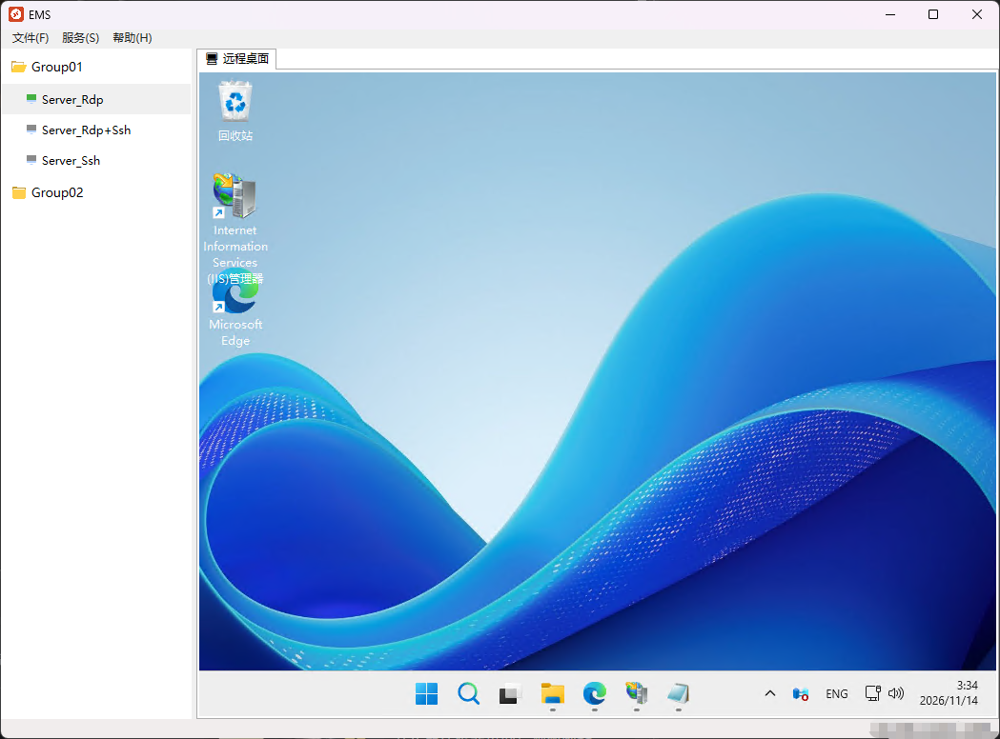
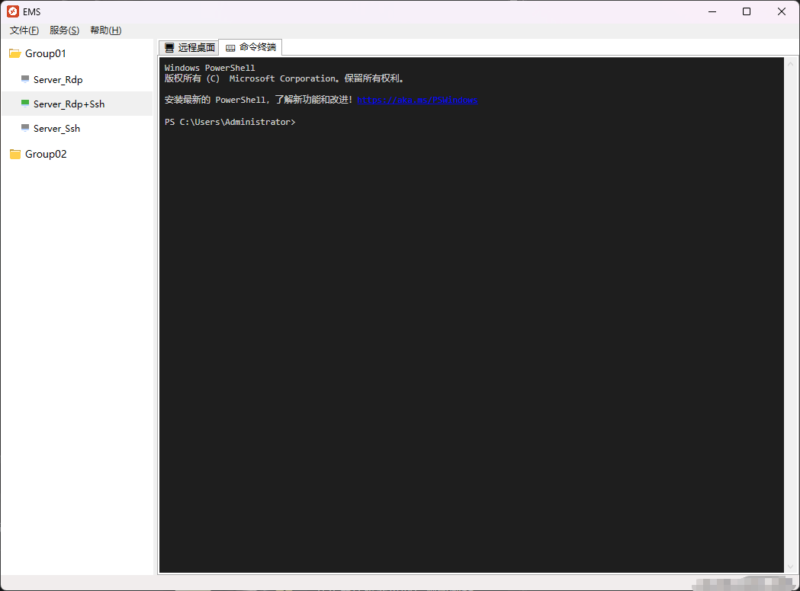
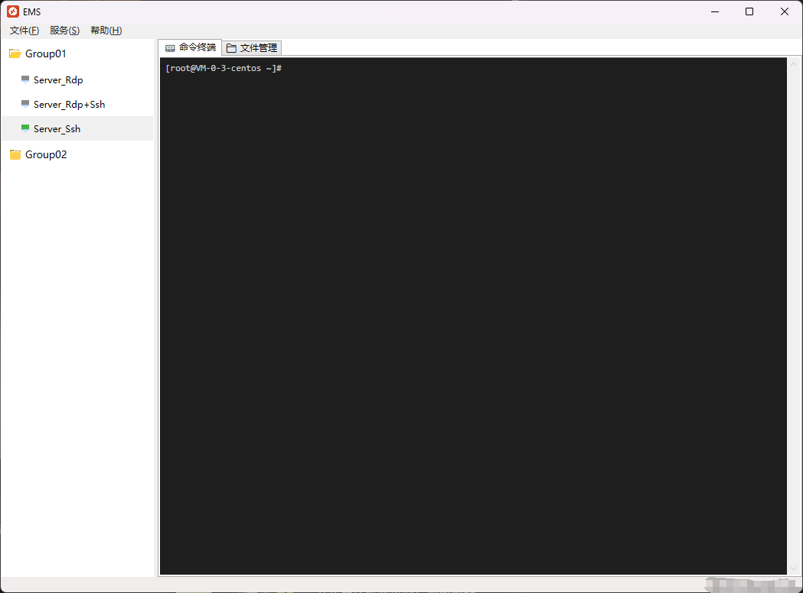
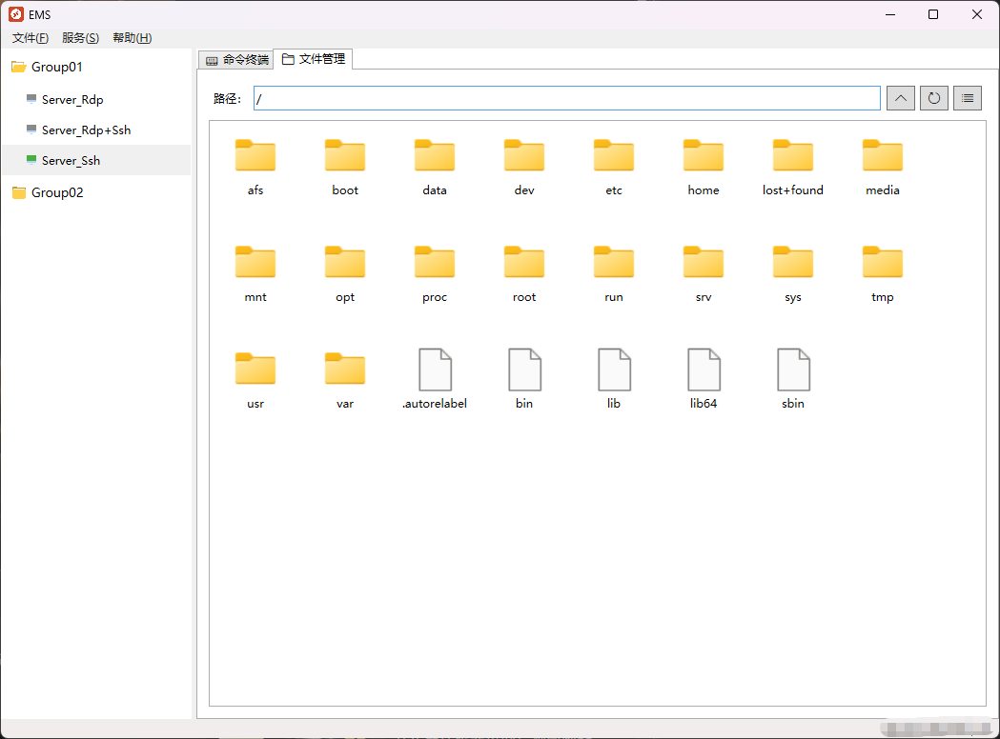

# EMS — 远程连接管理桌面应用

[English](README.md)

EMS 是一款 Windows 桌面远程运维工具，统一管理 SSH / RDP 连接，内置终端、SFTP 文件管理器，并集成 **MCP（Model Context Protocol）服务端**，让 AI 助手可以直接对已连接的服务器执行命令、传输文件。

## 界面预览

**RDP 远程桌面**（分辨率自动匹配可视区）



**RDP + SSH 组合**（远程桌面页签 + 命令终端页签，共用凭据）



**SSH 终端**（内嵌终端，OSC 133 Shell Integration）



**SSH + 文件管理**（资源管理器式 SFTP 浏览，拖拽/复制粘贴/传输队列）



## 功能特性

### 连接管理
- 服务器分组管理，账号/密码支持分组继承，端口随连接类型联动
- **SSH**：内嵌终端（XTerm.NET），支持 OSC 133 Shell Integration（精确的命令输出捕获与退出码）
- **RDP**：内嵌 ActiveX 远程桌面控件（mstscax），分辨率自动匹配可视区，启动时后台预热消除首次加载卡顿
- **RDP + SSH 组合**：远程桌面页签 + 命令终端页签（SSH 副连接懒加载），共用凭据

### 文件管理（SSH）
- 单栏资源管理器式 SFTP 浏览：框选、拖拽、复制粘贴
- 图标视图使用系统真实彩色图标，自动换行
- 上传/下载队列、进度显示，文件夹递归传输（含空目录）
- 远程文本编辑（AvalonEdit）

### MCP 工具层
进程内 MCP 服务端（Streamable HTTP，仅监听回环地址），端点：

```
http://localhost:<端口>/mcp
```

端口在应用设置中配置（`McpPort`，0 = 不启动）。提供的工具：

| 工具 | 说明 |
|---|---|
| `list_connected_servers` | 列出已连接服务器（名称/ID/协助能力/文件管理能力） |
| `run_command` | 短时命令，同步返回输出与退出码 |
| `start_long_command` | 启动长时命令（编译、tail -f 等），返回会话 ID |
| `read_command_output` | 按会话 ID 增量/全量读取长时命令输出 |
| `send_interrupt` | 向交互终端发送 Ctrl+C |
| `upload_file` | 上传文件/文件夹（递归，同名覆盖） |
| `download_file` | 下载文件/文件夹（递归，同名覆盖） |
| `set_file_permission` | chmod 设置远端权限 |

要点：
- 仅操作用户已在界面中手工连接的服务器；命令协助与文件传输均要求 SSH 连接
- 文件工具走 SFTP 通道；Windows 服务器路径兼容 `C:\x`、`C:/x`、`/C:/x` 三种写法（自动规范化）
- 命令输出经 OSC 133 标记精确分段；注入失败时自动退化为"回显过滤 + 静默收尾"模式（退出码不可靠但可用）
- Windows OpenSSH 服务器注入脚本经 SFTP 落盘 + `iex` 加载，兼容 Restricted 执行策略

## Windows 服务器开启 SSH 支持

EMS 的命令协助、文件传输与 RDP+SSH 组合页签均依赖目标 Windows 服务器运行 OpenSSH Server。在目标服务器上**以管理员身份**运行仓库根目录的 [OpenSSH.ps1](OpenSSH.ps1) 即可一键配置（幂等，可重复执行）：

1. 安装 OpenSSH Server（已安装则跳过）
2. `sshd` 设为自启并启动
3. 默认 Shell 设为 PowerShell 7（未安装则回退 5.1）
4. 放行防火墙 22 端口（规则已存在则跳过）

```powershell
# 在目标 Windows 服务器上（管理员 PowerShell）
.\OpenSSH.ps1
```

完成后在 EMS 中为该服务器开启 SSH 支持（RDP 类型勾选"支持 SSH"，或直接添加 SSH 连接），即可使用终端、文件管理与 MCP 协助。

## 技术栈

| 组件 | 用途 |
|---|---|
| .NET 10 (`net10.0-windows`) + WPF / WinForms 互操作 | 桌面 UI |
| SSH.NET 2025.1.0 | SSH / SFTP / 交互 Shell |
| XTerm.NET 3.0.2 | 终端模拟 |
| MSTSCLib ActiveX interop | RDP 远程桌面 |
| ModelContextProtocol.AspNetCore 1.2.0 | 进程内 MCP 服务端（Kestrel） |
| EF Core + SQLite | 本地数据（服务器/分组/配置），启动自动建库与轻量迁移 |
| AvalonEdit | 远程文本编辑 |

## 构建与运行

环境要求：Windows + .NET 10 SDK。

```powershell
# 开发运行
dotnet run --project EMS

# 发布（win-x64，框架依赖）
dotnet publish EMS -c Release -r win-x64 --self-contained false
```

单元测试：

```powershell
dotnet test EMS.Tests
```

> 提示：应用运行期间避免 `dotnet build` 主项目（文件占用）；测试项目构建不受影响。

## 项目结构

```
EMS.slnx
├─ EMS/                        # 主程序（WPF）
│  ├─ Services/
│  │  ├─ Connections/          # SSH/RDP 连接、Shell Integration 捕获、长时命令会话
│  │  ├─ Mcp/                  # MCP 服务端与工具定义
│  │  └─ Sftp/                 # SFTP 浏览、传输队列
│  ├─ ViewModels/              # MVVM 视图模型（页签、服务器树、主窗口）
│  ├─ Common/                  # 终端控件、路径格式化等纯逻辑
│  ├─ Models/ Data/            # 实体与 EF Core 数据访问
│  ├─ Dialogs/                 # 编辑/设置对话框
│  └─ ActiveX/                 # RDP interop DLL
├─ EMS.Tests/                  # xUnit 单元测试（捕获器状态机、路径转换等）
└─ Docs/                       # 界面截图
```

## MCP 客户端接入示例

```json
{
  "mcpServers": {
    "EMS": {
      "type": "http",
      "url": "http://localhost:8791/mcp"
    }
  }
}
```

先在 EMS 界面连接目标服务器，AI 即可通过上述工具进行运维协助。

### 接入 AI 备注

EMS（MCP）是服务器终端连接工具，支持 Windows（PowerShell）和 Linux。它**并非一直运行**——AI 客户端里 MCP 状态显示"不可用"并不代表真的不可用，可能只是 EMS 尚未启动或刚重启。**使用对应 MCP 服务前应先探测**（如调用一次 `list_connected_servers`），确认可用后再执行后续操作；探测失败时提示用户启动 EMS 并连接服务器，而不是直接判定工具不可用。
